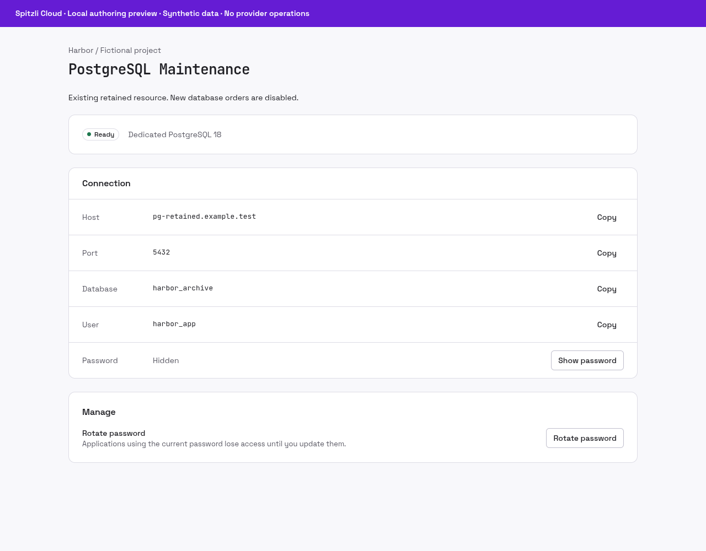

# PostgreSQL Maintenance


Maintain PostgreSQL resources that already exist and have been retained.

## What you can do

View existing shared or dedicated resource state, reveal or rotate credentials with permission, and explicitly delete retained resources when authorized.

## Setup and access

Operator-maintained legacy service. New shared and dedicated database orders are disabled. Use Neon BYOK for new database connections; installing this release does not enable ordering.

## Data and security

Project ownership is rechecked for every action. Stored passwords are sealed and revealed only explicitly. Existing data, encryption keys and retained resources must be preserved during maintenance.

## Status and limits

Legacy beta, not a new managed database offering. The screenshot shows a synthetic existing resource. TLS and verified host configuration are operator responsibilities; this plugin does not imply backup or point-in-time recovery coverage.

Catalog publication does not activate the plugin, enable public signup or grant
access to any customer resource. A new presentation release must use a new version;
previously signed releases and their assets stay immutable.

## Gallery

Actual maintenance panel; synthetic existing database. New orders remain disabled; no database was created.



## Catalog source

`.tabularium` is the complete catalog-refresh source. It retains the immutable
runtime image and full protocol/access contract of the currently released
`0.1.0` and adds the prepared presentation assets. Refresh it only from a
reviewed immutable source commit. This does not replace signed release assets
or activate the runtime.

## Technical reference

The retained implementation notes below include platform integration procedures.
Commands referring to Core, `tools/` or `apps/console` require the [platform source
checkout](https://github.com/spitzli/webdock); they are not standalone setup steps.

This release maintains existing retained PostgreSQL resources only. New shared and self-hosted database orders are disabled; Neon BYOK is the default for new database connections. Publishing this artifact does not install it, create customers or databases, enable orders, or delete existing data. Core keeps `WEBDOCK_DATABASE_NEW_ORDERS_ENABLED=false`.

The retained maintenance protocol supports the existing resource types:

- **Shared database:** a login role and a database on a shared server from the private configuration. The role gets `CONNECT` and `TEMPORARY` on its own database only; `PUBLIC` loses `CONNECT` on every database, including `postgres` and `template1`.
- **Dedicated instance:** a PostgreSQL server of its own, placed through `plugin.workloads`: a CloudNativePG cluster with the customer role's password in a Secret the operator reconciles (rotation is a new apply), and a Traefik TCP route that passes TLS through by server name (`pg-<id>.<domain>`). With `issuer` set, cert-manager issues each instance a certificate for that host and clients connect with `sslmode=verify-full`; without it they use `sslmode=require`. Locally it runs on the dev k3s, answers on port 55442 and is issued by the local CA (`.dev-local/ca/ca.crt`).

State lives in the plugin's own database (`storageUrl`); migrations run at startup under an advisory lock. Passwords are generated (hex), stored AES-256-GCM sealed with `secretKeyHex` and bound to the resource id, and are returned only by `databases.credentials`. Every resource action re-checks that the resource belongs to the invoking project. Database URLs must be loopback until TLS is configured.

The React UI in `ui/` is bundled by the Console and shown on the resource page.

```sh
cargo test --locked                    # manifest contract
# Real PostgreSQL (disposable, loopback); Core and the cluster are stood in for:
WEBDOCK_POSTGRES_PLUGIN_TEST_ADMIN_URL=postgres://… \
  cargo test --locked -- --include-ignored
```
